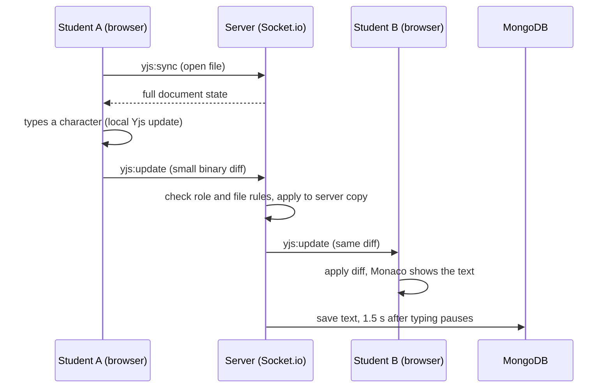

# CodeSync

**A real-time collaborative code editor for classrooms and lab examinations.**

Several people edit the same file at once and see each other's cursors live. Teachers can run classrooms and timed lab exams with a server-controlled clock, and every permission is enforced on the server.

- **Live app:**  https://collaborative-code-editor-zeta.vercel.app/
- **API:** `https://collaborative-code-editor-zp9o.onrender.com` (health check: `/api/health`)
- **Repository:** `https://github.com/chennojusaipranathi/Collaborative_Code_Editor`

> **Note on the live demo:** the backend runs on a free Render instance. It sleeps after about 15 minutes of inactivity, so the first request can take around a minute to wake it.

---

## Table of contents

1. [Features](#features)
2. [Tech stack](#tech-stack)
3. [Architecture](#architecture)
4. [How real-time collaboration works](#how-real-time-collaboration-works)
5. [Roles and permissions](#roles-and-permissions)
6. [Room modes](#room-modes)
7. [Security design](#security-design)
8. [Getting started](#getting-started)
9. [Environment variables](#environment-variables)
10. [Testing](#testing)
11. [API reference](#api-reference)
12. [Socket events](#socket-events)
13. [Data model](#data-model)
14. [Project structure](#project-structure)
15. [Deployment](#deployment)
16. [Screenshots](#screenshots)
17. [Known limitations](#known-limitations)
18. [Future improvements](#future-improvements)

---

## Features

**Collaboration**
- Multiple users editing the same file at the same time, merged without conflicts (Yjs CRDT)
- Live cursors, colored selections and name labels
- Online and offline presence, plus a badge showing who is viewing each file
- Reconnect handling: the editor pauses while offline and resyncs when the connection returns
- Room chat with history, typing indicator and unread badge
- Role changes and new members appear live for everyone in the room

**Editor**
- Monaco editor (the engine behind VS Code) with syntax highlighting for JavaScript, TypeScript, Python, Java and C++
- File explorer: create, rename and delete files, with a tab for each open file
- Format code, theme picker (follows the app's light and dark mode), font size
- Problems panel fed by Monaco's real diagnostics
- Run code with custom stdin, stdout, stderr, compile errors, execution time and run history, in a sandbox (never on the app server)

**Rooms and sharing**
- Create rooms, join by 6-character code, search your rooms
- Invite links where the owner chooses **view only** or **view and edit**, with an expiry and a revoke button
- Version history: automatic and manual snapshots, side-by-side Monaco diff, restore with an automatic backup

**Classroom mode**
- Every student gets a private file, hidden from other students
- Teacher monitor: live status, code previews, tab filters and "Open editor" for any student
- Raise hand with instant notifications, and lock or unlock student editing
- Assign a task with a deadline, collect submissions, view and compare them

**Lab exam mode**
- Server-authoritative timer: refreshing, closing the tab or changing the computer clock changes nothing
- Auto-submit at time-up, even if the student's browser is closed
- Disclosed tab-switch and paste counters, kept by the server
- Exam lockdown: no shared files, no chat, no AI assistant, and only your own run history
- Teacher monitor, grading with feedback, and a basic similarity estimate (clearly labelled as an estimate)

**AI assistant**
- Explain code, find bugs, suggest improvements, or ask a question about the open file
- Called through the backend so the API key never reaches the browser
- Clearly labelled mock mode when no key is configured

---

## Tech stack

| Layer | Technology |
|---|---|
| Frontend | React, Vite, Tailwind CSS v4, React Router, Lucide icons (plain JavaScript) |
| Editor | Monaco Editor (`@monaco-editor/react`) including the DiffEditor |
| Collaboration | Yjs, `y-monaco`, `y-protocols` (awareness), Socket.io |
| Backend | Node.js, Express 5, Socket.io |
| Database | MongoDB Atlas with Mongoose |
| Auth | JWT, bcryptjs |
| Validation | Zod |
| Hardening | helmet, CORS allow-list, express-rate-limit |
| Code execution | Judge0 (sandboxed) behind a provider interface, plus a mock provider |
| AI | Provider interface with a mock mode and real providers (Groq in the author's deployment) |
| Tests | Node test runner (backend), Vitest and Testing Library (frontend) |
| Hosting | Vercel (frontend), Render (backend), MongoDB Atlas (database) |

Shared state uses React Context and custom hooks.

---

## Architecture

```text
┌──────────────────────────── BROWSER (frontend/) ────────────────────────────┐
│  React + Vite + Tailwind                                                    │
│  ┌──────────────┐   ┌─────────────────┐   ┌───────────────────────────┐     │
│  │ Context +    │   │ Monaco Editor   │◄──┤ Yjs document + y-monaco   │     │
│  │ custom hooks │   └─────────────────┘   └─────────────┬─────────────┘     │
│  └──────────────┘                                       │                   │
└────────────┬────────────────────────────────────────────┼───────────────────┘
             │ HTTPS (REST, JSON)                         │ WebSocket (Socket.io)
             ▼                                            ▼
┌──────────────────────────── SERVER (backend/) ──────────────────────────────┐
│  Express: routes ─► middleware (auth, role, validation, rate limit)         │
│                          │                                                  │
│                   controllers ───────────────► services/execution ─► Judge0 │
│                          │                     services/ai ─────────► LLM   │
│  Socket.io: auth ─► handlers (yjs, chat, classroom, presence)               │
│                          │                                                  │
│            in-memory Yjs documents (saved to MongoDB, debounced)            │
└──────────────────────────┼──────────────────────────────────────────────────┘
                           ▼
                    MongoDB Atlas
```

**Why HTTP and WebSockets both?**

| | HTTP (REST) | WebSocket (Socket.io) |
|---|---|---|
| Connection | A new request each time | One long-lived connection |
| Who can start a message | The client only | Either side, at any time |
| Used here for | Login, rooms, files, history, grading, running code | Typing, cursors, chat, presence, live updates |

**Where MongoDB fits:** it holds everything that must outlive a session: users, rooms, files, snapshots, chat, exams and submissions. It is not in the live typing path. Live editing happens in memory, and the server saves to MongoDB after typing pauses.

---

## How real-time collaboration works

Socket.io and Yjs solve different problems:

- **Socket.io is the transport.** It carries messages, handles rooms, reconnects and authentication.
- **Yjs is the merge engine.** It is a CRDT: edits made on different copies at the same moment merge into the same result everywhere, in any order. Plain text broadcasting would lose or scramble edits.



Details that make it robust:

- **One Yjs document per file, per room**, so rooms are isolated.
- **Origin tags** stop echo loops: updates that came from the server are never sent back to it.
- **The role is checked on every update**, so demoting someone blocks their very next keystroke without a reconnect.
- **The server is the only writer** to MongoDB, saving the merged text, so two clients can never overwrite each other's work.
- **Cursors use Yjs awareness**, a separate channel that is never saved. Cursors are removed when a user switches files or disconnects.
- **Snapshots versus Yjs updates:** updates are tiny diffs for live syncing and are not stored. Snapshots are full, labelled copies that people browse, compare and restore.

---

## Roles and permissions

Permissions belong to a **room membership**, not to the account. The same person can be the owner of one room and a viewer in another.

| Capability | Owner | Editor | Viewer |
|---|:--:|:--:|:--:|
| Read files, history and chat | yes | yes | yes |
| Edit code and create, rename or delete files | yes | yes (see modes) | no |
| Run code | yes | yes | no |
| Create and restore snapshots | yes | yes | no |
| Create invite links, change roles | yes | no | no |
| Classroom monitor, tasks, lock | yes | no | no |
| Exam setup, grading, similarity | yes | no | no |

Every row is enforced by the backend. Hiding a button in the interface is only a convenience.

---

## Room modes

| Mode | Who creates it | What is different |
|---|---|---|
| **Free Coding** | Anyone | Shared files, everyone with edit rights edits together |
| **Classroom** | Teachers | Each student has a private file, the teacher monitors and can lock editing, tasks and submissions |
| **Lab Exam** | Teachers | Each student works in their own timed session, with no shared files, no chat and no AI |

---

## Security design

- **Passwords** are hashed with bcrypt and never returned by the API.
- **JWT** authentication on every protected route and on every socket connection. Tokens signed with another secret, expired tokens and unsigned (`alg: none`) tokens are all refused.
- **Role checks on the server** through reusable middleware, and again inside socket handlers.
- **No information leaks:** a stranger gets the same 404 for a room that does not exist and a room they are not in. Login failures use one message for both "unknown email" and "wrong password".
- **Resources are always looked up inside their room**, so a file from room B cannot be reached through room A's URL.
- **Input validation** with Zod on every request. Objects and arrays are rejected where text is expected, which blocks NoSQL-style injection.
- **Rate limiting** on login and registration, the API in general, code runs, exam requests and AI calls.
- **Untrusted code never runs on the app server.** It goes to a sandbox with CPU, memory and time limits.
- **helmet** sets safe headers, and CORS only allows the frontends listed in `CLIENT_URL`.
- **Body and socket message size limits** (1 MB).
- **The server refuses to start in production** with a weak `JWT_SECRET`, a missing `CLIENT_URL`, or a non-https frontend address.
- **Exam integrity:** the deadline is computed on the server, counters can only go up, and a late save or submit is rejected by the database query itself.
- **Monitoring is disclosed:** students are told that tab switches and pastes are counted, and the screens state that these are context for a human, not proof of cheating.
- **AI assistant:** student code is treated as untrusted data in the prompt, answers are rendered as plain text, and the assistant is off for students during exams.

---

## Getting started

### Prerequisites

- Node.js 20 or newer
- A free MongoDB Atlas cluster (a connection string for a database called `codesync`)
- Git

### 1. Clone and install

```powershell
git clone https://github.com/chennojusaipranathi/Collaborative_Code_Editor.git
cd Collaborative_Code_Editor

cd backend
npm install
cd ../frontend
npm install
cd ..
```

### 2. Configure the backend

Copy `backend/.env.example` to `backend/.env` and fill in the values (see [Environment variables](#environment-variables)). Generate a strong secret with:

```powershell
node -p "require('crypto').randomBytes(48).toString('hex')"
```

### 3. Configure the frontend

Create `frontend/.env`:

```env
VITE_API_URL=http://localhost:5000
```

### 4. Run both servers (two terminals)

```powershell
# Terminal 1
cd backend
npm run dev        # http://localhost:5000

# Terminal 2
cd frontend
npm run dev        # http://localhost:5173
```

Open http://localhost:5173, register a teacher and a student, and try a room in two browser windows.

> **Tip:** each browser tab keeps its own login, so you can test two accounts side by side in one browser.

---

## Environment variables

### Backend (`backend/.env`)

| Variable | Required | Description |
|---|:--:|---|
| `MONGODB_URI` | yes | Atlas connection string, ending in the database name (`.../codesync?...`) |
| `JWT_SECRET` | yes | Long random secret for signing tokens (at least 32 characters in production) |
| `CLIENT_URL` | prod | Frontend origin(s), comma-separated, with no trailing slash. Must be `https` in production |
| `NODE_ENV` | prod | Set to `production` when deployed |
| `PORT` | no | Defaults to 5000. Hosting platforms set it themselves |
| `MONGODB_URI_TEST` | tests | A separate database (name must contain `test`). Tests refuse to run without it |
| `EXECUTION_PROVIDER` | no | `judge0` (default) or `mock` |
| `JUDGE0_URL` | no | Defaults to `https://ce.judge0.com` |
| `JUDGE0_AUTH_TOKEN` | no | Only for Judge0 hosts that need a key |
| `AI_PROVIDER` | no | `mock` (default) or a real provider |
| `ANTHROPIC_API_KEY`, `AI_MODEL` | no | Used by the Anthropic provider |
| TODO: your Groq variable names | no | Add the exact names from your own `.env` (never the values) |

### Frontend (`frontend/.env`)

| Variable | Description |
|---|---|
| `VITE_API_URL` | The backend address. The socket connection uses it too |

Never commit `.env` files. Only `.env.example` files belong in Git.

---

## Testing

```powershell
# Backend: API, classroom, exam, real-time and security suites
cd backend
npm test

# Frontend: utilities, hooks, components and pages
cd frontend
npm test
npm run lint
```

**Backend tests** start the real app against a separate `codesync_test` database and send real HTTP and WebSocket traffic. They never touch your real data, and they refuse to run unless the database name contains "test". They prove, among other things:

- passwords are stored hashed, and forged, unsigned and expired tokens are rejected
- a stranger cannot learn whether a room exists, and a file from another room cannot be reached through this room's URL
- students cannot create classroom or exam rooms, viewers cannot write, run or snapshot
- a student cannot read or edit another student's file, and locking applies immediately
- the exam end time is set by the server, the clock cannot be restarted, and an exam is auto-submitted without any browser open
- two users typing at the same moment end up with identical text, which is then saved to MongoDB
- a demoted editor is blocked on the very next edit over the same connection
- NoSQL-style payloads are rejected, and oversized bodies get a clean 413

**Frontend tests** (41 tests in 12 files) cover time formatting, the exam countdown (including that it uses the server's clock), the API helper, reusable components, route protection and the login flow.

---

## API reference

All routes are under `/api`. Everything except `/health`, `/auth/register` and `/auth/login` needs `Authorization: Bearer <token>`. Errors are JSON: `{ "message": "..." }`.

### Auth and health

| Method | Path | Description |
|---|---|---|
| GET | `/health` | Service and database status |
| POST | `/auth/register` | Create an account (`student` or `teacher`) |
| POST | `/auth/login` | Log in, returns `{ user, token }` |
| GET | `/auth/me` | The current user |

### Rooms, members and invites

| Method | Path | Who | Description |
|---|---|---|---|
| GET | `/rooms` | member | List my rooms |
| POST | `/rooms` | any (teachers for classroom and exam) | Create a room |
| POST | `/rooms/join` | any | Join by room code (becomes editor) |
| GET | `/rooms/:roomId` | member | Room details and my role |
| GET | `/rooms/:roomId/participants` | member | Members and roles |
| PATCH | `/rooms/:roomId/participants/:userId` | owner | Change a member's role |
| POST, GET | `/rooms/:roomId/invites` | owner | Create or list invite links |
| DELETE | `/rooms/:roomId/invites/:inviteId` | owner | Revoke a link |
| GET | `/invites/:token` | any | Preview an invite |
| POST | `/invites/:token/accept` | any | Accept: the link sets your role (the owner is never changed) |

### Files, history, running code, chat, AI

| Method | Path | Who | Description |
|---|---|---|---|
| GET, POST | `/rooms/:roomId/files` | viewer, editor | List or create files |
| PATCH, DELETE | `/rooms/:roomId/files/:fileId` | editor | Rename, change or delete a file |
| GET, POST | `/rooms/:roomId/files/:fileId/snapshots` | viewer, editor | List or create snapshots |
| GET | `.../snapshots/:snapshotId` | viewer | One snapshot with its text |
| POST | `.../snapshots/:snapshotId/restore` | editor | Restore (a backup is saved first) |
| POST | `/rooms/:roomId/run` | editor | Run code in the sandbox |
| GET | `/rooms/:roomId/runs` | viewer | Recent runs |
| GET | `/rooms/:roomId/messages` | viewer | Last 50 chat messages |
| POST | `/rooms/:roomId/ai` | viewer | Ask the assistant (off for exam students) |

### Classroom

| Method | Path | Who | Description |
|---|---|---|---|
| GET | `/rooms/:roomId/classroom` | owner | Monitor data for all students |
| PATCH | `/rooms/:roomId/lock` | owner | Lock or unlock student editing |
| GET | `/rooms/:roomId/task` | member | The assigned task |
| PUT, DELETE | `/rooms/:roomId/task` | owner | Assign, edit or remove the task |
| POST | `/rooms/:roomId/task/submit` | editor | Submit my own file |
| GET | `/rooms/:roomId/submissions` | owner | All submissions |

### Lab exam

| Method | Path | Who | Description |
|---|---|---|---|
| GET | `/rooms/:roomId/exam` | member | Exam info and my session |
| PUT, DELETE | `/rooms/:roomId/exam` | owner | Set up, change or remove the exam |
| PATCH | `/rooms/:roomId/exam/open` | owner | Open or close the exam |
| POST | `/rooms/:roomId/exam/start` | editor | Start my session (the server sets the end time) |
| PUT | `/rooms/:roomId/exam/session` | editor | Autosave my code |
| POST | `/rooms/:roomId/exam/session/event` | editor | Record a tab switch or paste |
| POST | `/rooms/:roomId/exam/session/submit` | editor | Submit |
| GET | `/rooms/:roomId/exam/sessions` | owner | Live monitor of all students |
| GET | `/rooms/:roomId/exam/sessions/:studentId` | owner | One student's code |
| PATCH | `/rooms/:roomId/exam/sessions/:studentId/grade` | owner | Grade and feedback |
| GET | `/rooms/:roomId/exam/similarity` | owner | Basic similarity estimate |

---

## Socket events

The socket must present a valid JWT in the handshake, and joining a room is checked against the database.

| Event | Direction | Purpose |
|---|---|---|
| `room:join`, `room:leave` | client to server | Enter or leave a room's live group |
| `presence:update` | server to clients | Who is online and which file they have open |
| `file:focus` | client to server | Which file I have open |
| `yjs:sync`, `yjs:unsync` | client to server | Open or close a shared document |
| `yjs:update` | both ways | A document change (binary diff) |
| `awareness:update`, `awareness:query` | both ways | Cursors, selections and names |
| `chat:send` | client to server | Send a message |
| `chat:message`, `chat:typing` | server to clients | New message, typing signal |
| `hand:raise`, `hand:dismiss`, `hand:sync` | client to server | Raise hand (students), dismiss (teacher) |
| `classroom:hands` | server to clients | Who has a raised hand |
| `room:changed` | server to clients | Members, roles or files changed: reload |
| `task:changed` | server to clients | The task changed: reload |

---

## Data model

| Collection | Holds |
|---|---|
| `User` | name, email, password hash, account role |
| `Room` | name, code, mode, language, owner, locked |
| `RoomParticipant` | user, room and the role in that room (unique per pair) |
| `File` | room, name, content, optional owner (a student's private file) |
| `VersionSnapshot` | labelled copies of a file (auto, manual, backup) |
| `Message` | chat messages |
| `Execution` | code run history |
| `Invite` | token, role, expiry (deleted automatically by a TTL index) |
| `Task`, `Submission` | classroom assignment and student submissions |
| `Exam`, `ExamSession` | exam setup, and each student's timed session with counters and grade |

---

## Project structure

```text
Collaborative_Code_Editor/
├── backend/
│   ├── config/            env checks and database connection
│   ├── controllers/       request handlers (auth, rooms, files, exam, ...)
│   ├── middleware/        auth, room roles, validation, rate limits, errors
│   ├── models/            Mongoose schemas
│   ├── routes/            route definitions
│   ├── services/
│   │   ├── execution/     Judge0 and mock providers behind one interface
│   │   └── ai/            AI providers behind one interface
│   ├── sockets/           Socket.io: auth, presence, Yjs, chat, classroom
│   ├── utils/             validators, access rules, similarity, token helper
│   ├── tests/             API, classroom, exam, real-time and security tests
│   ├── app.js             builds the Express app (no listening)
│   └── server.js          connects the database and starts listening
├── frontend/
│   ├── src/
│   │   ├── components/    common, layout, editor, dashboard, classroom, exam, history
│   │   ├── pages/         Landing, Login, Register, Dashboard, Editor, History,
│   │   │                  Classroom, Exam, Submissions, Join, NotFound
│   │   ├── hooks/         data and logic (workspace, collaboration, chat, ...)
│   │   ├── services/      all API and socket calls
│   │   ├── contexts/      theme and auth state
│   │   └── utils/         small pure helpers
│   └── vercel.json        single-page-app rewrite
└── README.md
```

**Design choices worth knowing:**

- Business logic lives in hooks and services, not in components. Screens were first built on mock services, and each was replaced by real API calls without changing the pages.
- `app.js` and `server.js` are separate so tests can load the app without opening a port.
- Execution and AI both sit behind a provider interface, so switching provider means editing one file.

---

## Deployment

| Part | Host |
|---|---|
| Database | MongoDB Atlas (free M0) |
| Backend | Render web service (root directory `backend`) |
| Frontend | Vercel (root directory `frontend`) |

**Backend on Render:** build command `npm install`, start command `npm start`, health check path `/api/health`. Set `NODE_ENV=production`, `MONGODB_URI`, `JWT_SECRET` (new, 32 or more characters), `CLIENT_URL` (the Vercel address, https, no trailing slash) and the execution and AI variables.

**Frontend on Vercel:** set `VITE_API_URL` to the Render address. `vercel.json` makes refreshing `/room/...` and opening invite links work.

**Deploy order:** Render first (to get its address), then Vercel, then set `CLIENT_URL` on Render and let it restart.

**Free-tier behaviour:**

- A free Render service sleeps after 15 minutes without an HTTP request or WebSocket message, and waking takes about a minute.
- The disk is temporary, which is fine because all data is in Atlas.
- Server memory is lost on restart: raised hands, rate-limit counters and online status rebuild themselves.
- On shutdown (`SIGTERM`) the server saves any open documents first.

---


## Known limitations

These are deliberate trade-offs for a project at this scale.

- **Anyone can register as a teacher.** Teacher powers apply only to rooms the teacher owns, but a real deployment should approve teacher accounts.
- **The login token is kept in browser storage per tab**, so closing a tab logs you out, and a cross-site scripting bug could expose it. httpOnly cookies with CSRF protection are safer.
- **Rate limits and presence live in server memory.** They reset on restart and are not shared between several servers. Running more than one backend instance would need a Redis adapter for Socket.io and a shared limiter store.
- **The public Judge0 sandbox is shared and rate limited.** A production deployment should self-host Judge0.
- **The similarity check is a basic text-overlap estimate.** It compares runs of tokens between submissions. It can be defeated by renaming variables, and short or common solutions can match by chance. The screens say so, and a high value is a reason to read the code, not a verdict.
- **Tab-switch and paste counts can be accidental.** They are disclosed to students and used only as context.
- **Documents too large to record:** files over 200,000 characters cannot be saved, and the assistant accepts at most 20,000 characters.
- **No end-to-end browser tests.** The suites cover the API, sockets and components, but not full browser flows.
- **Session replay is not implemented.** Version history with snapshots, diff and restore is.
- **A crash can lose the last second or two of typing** (saves happen 1.5 seconds after typing pauses).

---

## Future improvements

- Session replay with a timeline, play and pause, and playback speed
- Self-hosted Judge0 with Docker for reliable limits and privacy
- Teacher approval flow, and httpOnly cookie sessions
- Redis for shared presence, rate limits and multi-instance Socket.io
- Real similarity analysis (AST-based, or a dedicated engine)
- Offline editing that merges on reconnect (possible with Yjs state vectors)
- Several exam problems with per-question grades
- End-to-end tests with Playwright
- Room deletion, and a teacher's archive of finished classes

---

## Author

TODO: your name, college, department, year, and guide's name.
